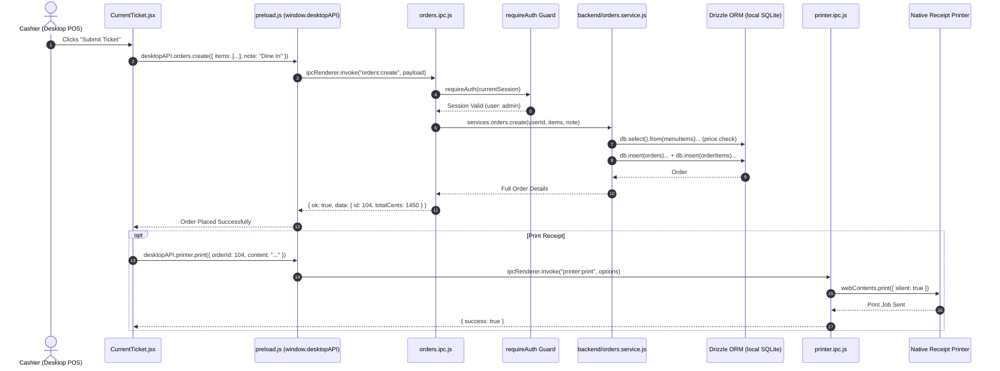
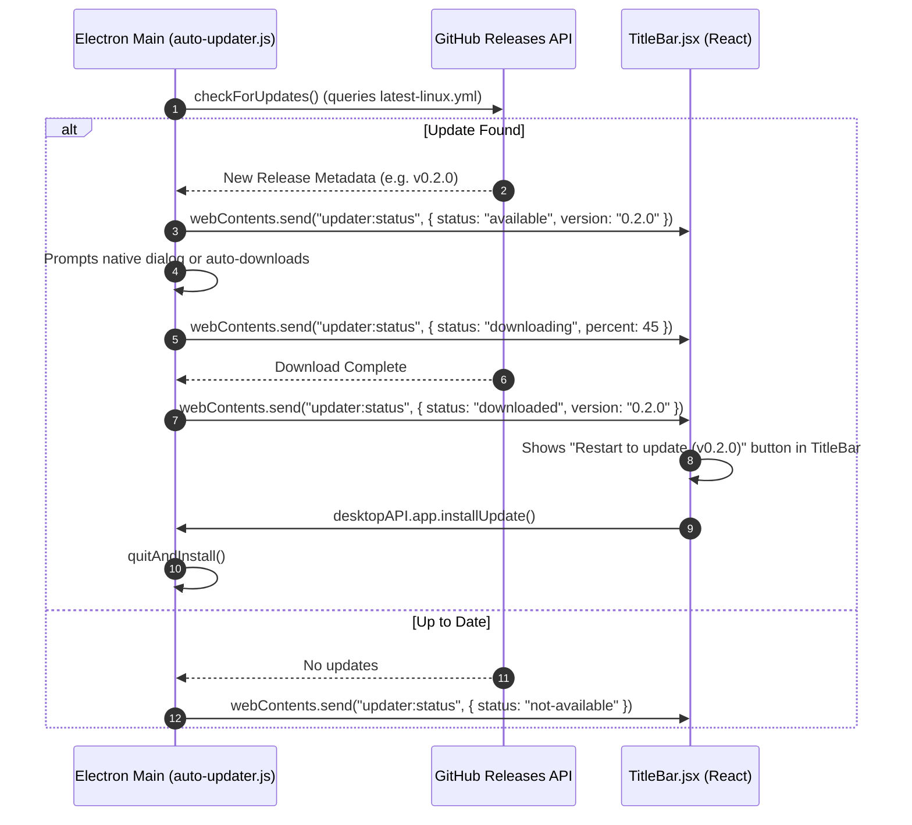

# Desktop Architecture & Developer Guide

Welcome to the desktop documentation for the **Restaurant & Cafe Order Management Desktop Application** (`@restaurant/desktop`). This guide provides an end-to-end technical overview of the Electron architecture, process models, in-process SQLite database engine, IPC communication channels, remote update pipeline via GitHub Releases, developer recipes, and maintenance guidelines.

---

## Table of Contents

1. [High-Level Overview & Architecture](#1-high-level-overview--architecture)
2. [Subsystem Connectivity & Architecture (Mermaid Graph)](#2-subsystem-connectivity--architecture)
3. [Sample End-to-End Action Trace (Mermaid Sequence)](#3-sample-end-to-end-action-trace)
4. [Starting, Packaging & Stopping (Lifecycle)](#4-starting-packaging--stopping)
5. [Database Engine & First-Run Auto-Seeder](#5-database-engine--first-run-auto-seeder)
6. [Security Hardening & Sandboxing](#6-security-hardening--sandboxing)
7. [Remote Updates Pipeline (GitHub Releases)](#7-remote-updates-pipeline)
8. [How to Add a New Desktop Feature (Developer Recipe)](#8-how-to-add-a-new-desktop-feature)
9. [Maintenance, Testing & Troubleshooting](#9-maintenance-testing--troubleshooting)

---

## 1. High-Level Overview & Architecture

The desktop application is built with **Electron v39.8.10** and packaged using **electron-builder**. It is engineered as a true **offline-first point-of-sale (POS) terminal**:

* **Zero Network Dependency**: Runs completely standalone. It embeds an in-process SQLite database via `better-sqlite3` and executes backend business services directly without requiring an HTTP server or active internet connection.
* **Dual Runtime Targets**:
  1. **Development Mode**: Boots Electron with `VITE_DEV_SERVER_URL` (`http://localhost:5173`) for instant Vite HMR while sharing the local development SQLite database.
  2. **Packaged Standalone Binary**: Loads bundled production frontend assets (`file://.../frontend/dist/index.html`) from the ASAR archive and stores its SQLite database securely in the user's OS application directory (`app.getPath("userData")/data/restaurant.sqlite`).
* **Clean Modular Separation**: Structured into single-responsibility domain modules (`config`, `db`, `ipc`, `window`, `updater`, `logger`) orchestrated by a concise `src/main.js` (~50 lines).

---

## 2. Subsystem Connectivity & Architecture

The following diagram illustrates how the Electron main process, preload context bridge, backend domain services, and renderer UI communicate:

```mermaid
flowchart TD
    subgraph RendererProcess ["Renderer Process (Frontend UI)"]
        UI["React 19 UI (Vite SPA)"]
        TitleBar["TitleBar.jsx (Custom Frameless Controls)"]
        APIClient["src/api/client.js (Desktop Mode Adapter)"]
        
        UI --> APIClient
        TitleBar --> APIClient
    end

    subgraph PreloadBoundary ["Preload Boundary (contextBridge)"]
        Bridge["window.desktopAPI (src/preload.js)"]
        AuthBridge["auth (login, logout, me, users)"]
        MenuBridge["menu (list, create, update, delete)"]
        OrdersBridge["orders (list, get, create, setStatus)"]
        DashBridge["dashboard (today)"]
        PrinterBridge["printer (list, print)"]
        AppBridge["app (info, updates)"]
        WinBridge["window (minimize, maximize, close)"]

        Bridge --> AuthBridge
        Bridge --> MenuBridge
        Bridge --> OrdersBridge
        Bridge --> DashBridge
        Bridge --> PrinterBridge
        Bridge --> AppBridge
        Bridge --> WinBridge
    end

    APIClient -->|ipcRenderer.invoke| Bridge

    subgraph MainProcess ["Main Process (Electron Orchestrator)"]
        MainOrchestrator["src/main.js"]
        Config["src/config/app.config.js"]
        Logger["src/logger.js (~/.restaurant-order-manager.log)"]
        WinManager["src/window/main-window.js (BrowserWindow)"]
        AutoUpdater["src/updater/auto-updater.js (electron-updater)"]
        
        MainOrchestrator --> Config
        MainOrchestrator --> Logger
        MainOrchestrator --> WinManager
        MainOrchestrator --> AutoUpdater
    end

    subgraph IPCLayer ["Domain IPC Dispatcher (src/ipc/)"]
        MasterIPC["src/ipc/index.js (registerAllIpc)"]
        AuthIPC["auth.ipc.js (Session State & Role Guards)"]
        MenuIPC["menu.ipc.js"]
        OrdersIPC["orders.ipc.js"]
        DashIPC["dashboard.ipc.js"]
        PrinterIPC["printer.ipc.js (Thermal Receipt Driver)"]
        AppIPC["app.ipc.js"]
        WindowIPC["window.ipc.js"]

        MasterIPC --> AuthIPC
        MasterIPC --> MenuIPC
        MasterIPC --> OrdersIPC
        MasterIPC --> DashIPC
        MasterIPC --> PrinterIPC
        MasterIPC --> AppIPC
        MasterIPC --> WindowIPC
    end

    MainOrchestrator --> MasterIPC
    Bridge -->|IPC Channels| IPCLayer

    subgraph DataAndServices ["Shared Business Services & Local DB"]
        LocalDB["src/db/local-db.js (initLocalDatabase & Seeder)"]
        BackendServices["app/backend/src/services/ (createServices)"]
        BackendDB["app/backend/src/database/ (openDatabase)"]
        SQLiteFile[("restaurant.sqlite (userData/data/)")]

        LocalDB --> BackendDB
        LocalDB --> BackendServices
        BackendDB --> SQLiteFile
        
        AuthIPC --> BackendServices
        MenuIPC --> BackendServices
        OrdersIPC --> BackendServices
        DashIPC --> BackendServices
    end

    MainOrchestrator --> LocalDB
```



---

## 3. Sample End-to-End Action Trace

Here is an end-to-end sequence diagram tracing a POS Cashier placing an order and printing a receipt in the desktop application:



---

## 4. Starting, Packaging & Stopping

### Available Scripts

Run these scripts from `app/desktop` or via root `pnpm`:

| Command | Action | Description |
| :--- | :--- | :--- |
| `pnpm dev` | Development Run | Launches Electron pointing to `http://localhost:5173`. |
| `pnpm package` | Offline Packaging | Runs `electron-builder --dir` and executes `scripts/inject-native.js`. Packaging takes ~20s offline. |
| `pnpm test` | Automated Tests | Headless unit and IPC test suite (`test/**/*.test.js`) using `mock-electron.js`. |
| `pnpm dist` | Full Release Build | Packages AppImage and tarball artifacts for GitHub Releases. |

### Offline Packaging & `electronDist`

In `app/desktop/package.json`:
```json
"build": {
  "electronVersion": "39.8.10",
  "electronDist": "node_modules/electron/dist",
  "npmRebuild": false
}
```
* **Why `electronDist` matters**: By default, `electron-builder` downloads a 113MB zip over the network via `@electron/get` on every build. By specifying `"electronDist": "node_modules/electron/dist"`, it copies the pre-installed local Electron distribution directly, reducing build time to ~20 seconds with **zero network downloads**.
* **Native Addon ABI Injection (`scripts/inject-native.js`)**: Electron v39 requires Node ABI 140 binaries. A post-package script copies the intact prebuilt `better_sqlite3.node` (ABI 140) into `dist/linux-unpacked/resources/app.asar.unpacked/node_modules/better-sqlite3/build/Release/`, preventing `ERR_DLOPEN_FAILED` errors.

### Application Lifecycle & Graceful Exit

* **Startup (`app.whenReady()`)**:
  1. Synchronously opens persistent logger (`initFileLogger`).
  2. Resolves SQLite database path in OS `userData` and runs Drizzle migrations.
  3. Executes First-Run Auto-Seeder if tables are empty.
  4. Registers all IPC handlers and instantiates `BrowserWindow`.
  5. Configures auto-updater event listeners.
* **Shutdown (`app.on('window-all-closed')`)**:
  - Closes SQLite WAL journal cleanly.
  - Flushes pending logs and exits process with code `0`.

---

## 5. Database Engine & First-Run Auto-Seeder

Local database operations are managed by `src/db/local-db.js`:

```
app.getPath("userData")/data/restaurant.sqlite
```

### Auto-Seeder Routine (`seedDatabaseIfEmpty`)
When the desktop application boots for the very first time on a new terminal, the auto-seeder:
1. Verifies if the `users` table has 0 records. If empty, automatically seeds default admin credentials:
   - **Username**: `admin`
   - **Password**: `admin123` (hashed via `node:crypto` `scryptSync`)
   - **Role**: `admin`
2. Verifies if `menu_items` has 0 records. If empty, inserts initial starter catalog items across categories (`Coffee`, `Food`, `Beverage`).
3. If records already exist, auto-seeding is completely bypassed (idempotent).

---

## 6. Security Hardening & Sandboxing

The desktop application enforces strict Electron security best practices:

1. **In-Window Navigation Guard (`will-navigate`)**:
   In `src/window/main-window.js`, any in-window navigation attempt away from local `file://` or dev URL is blocked via `event.preventDefault()` and opened externally using `shell.openExternal(url)`.
2. **Child Window Sandboxing (`setWindowOpenHandler`)**:
   Popups and `window.open()` calls are intercepted and denied (`{ action: "deny" }`), delegating links to the user's default system browser.
3. **Context Isolation**:
   `contextIsolation: true` and `nodeIntegration: false` prevent renderer scripts from accessing Node.js system APIs directly.
4. **IPC Authentication Guards**:
   Critical channels (`orders:create`, `menu:delete`, `auth:create-user`) enforce in-memory session checks (`requireAuth`, `requireAdmin`) inside main process handlers before executing backend services.

---

## 7. Remote Updates Pipeline

The desktop application integrates `electron-updater` with GitHub Releases:

### Build & Release Targets
* **Linux**: `"AppImage"` and `"dir"` targets in `package.json`.
* **Windows**: `"nsis"` installer.
* **Publish Provider**: GitHub Releases (`FIBA00/Order-mgmt`).

### Update Lifecycle & Event Broadcasting



---

## 8. How to Add a New Desktop Feature (Developer Recipe)

Follow this 5-step recipe to add a new desktop feature (e.g. **Barcode Scanner** support):

### Step 1: Add Backend Service Method
Ensure the domain logic exists in `app/backend/src/services/` (e.g. `barcode.service.js`).

### Step 2: Implement Desktop IPC Handler
Create `app/desktop/src/ipc/barcode.ipc.js`:
```javascript
const { ipcMain } = require("electron");

function registerBarcodeIpc(services) {
  ipcMain.handle("barcode:scan", async (_event, code) => {
    return services.menu.findByBarcode(code);
  });
}

module.exports = { registerBarcodeIpc };
```
Register it in `app/desktop/src/ipc/index.js`.

### Step 3: Expose via Preload Context Bridge
In `app/desktop/src/preload.js`:
```javascript
contextBridge.exposeInMainWorld("desktopAPI", {
  // ... existing namespaces
  barcode: {
    scan: (code) => ipcRenderer.invoke("barcode:scan", code),
  },
});
```

### Step 4: Wire Unified Frontend API Client
In `app/frontend/src/api/client.js`:
```javascript
export const api = {
  // ...
  barcode: {
    scan: (code) =>
      isDesktop
        ? window.desktopAPI.barcode.scan(code)
        : fetchJson(`/api/barcode/scan`, { method: "POST", body: JSON.stringify({ code }) }),
  },
};
```

### Step 5: Write Automated IPC Test
In `app/desktop/test/ipc.test.js`, invoke the channel and assert expected returns.

---

## 9. Maintenance, Testing & Troubleshooting

### Running Tests
The desktop test suite runs headless without requiring an X11/Wayland display server:
```bash
# Run all desktop unit and IPC integration tests
pnpm test
```
Tests verify:
* `test/config.test.js`: Path resolution and window geometry.
* `test/local-db.test.js`: SQLite initialization, auto-seeder idempotency, and Drizzle query operations.
* `test/ipc.test.js`: Security guards (`requireAuth`, `requireAdmin`), validation, window controls, and update channels.
* `test/logger.js`: Persistent logging and rotation.

### Persistent Logging (`~/.restaurant-order-manager.log`)
* All crashes, unhandled rejections, console logs, and updater events write synchronously to `~/.restaurant-order-manager.log`.
* Automatically rotates to `.old` when exceeding 5MB.
* To view live desktop logs in production:
  ```bash
  tail -f ~/.restaurant-order-manager.log
  ```
