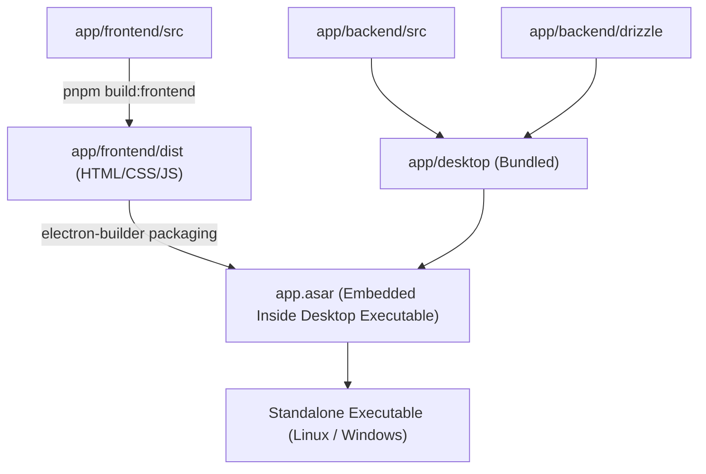
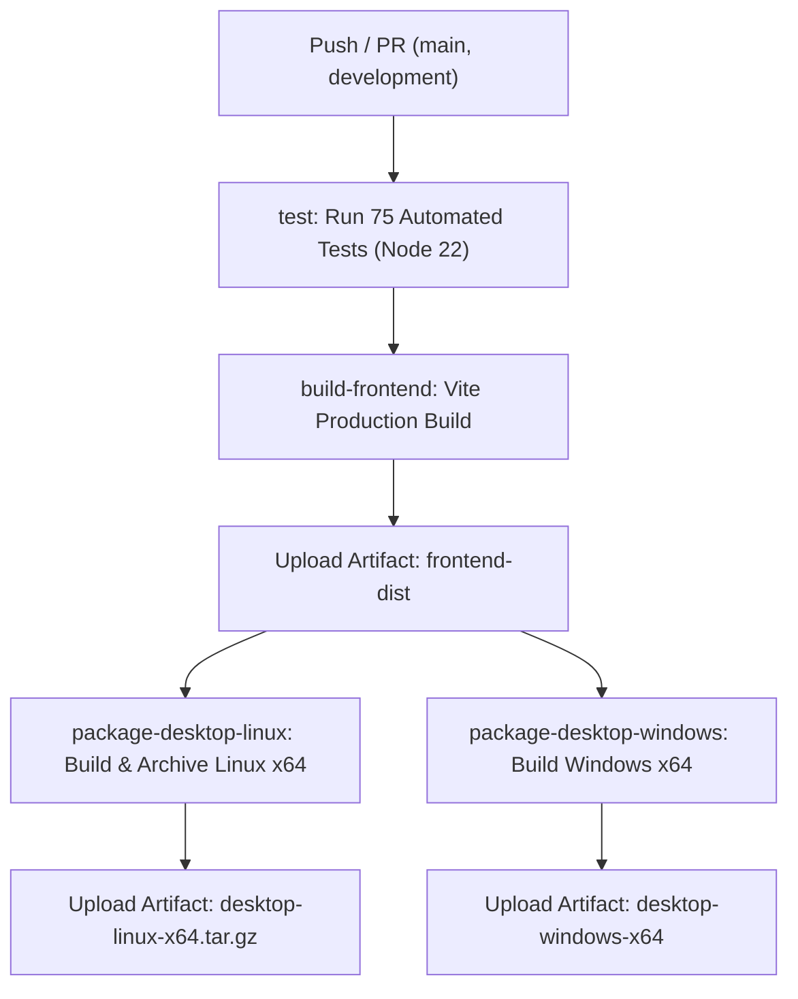
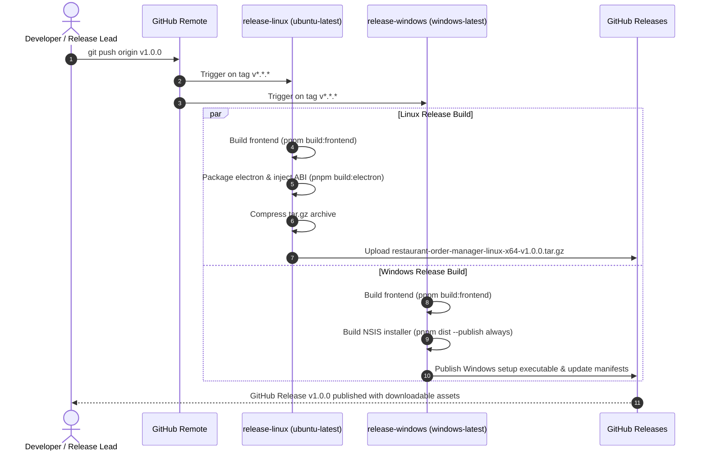

# Deployment & CI/CD Pipeline Guide

This guide details the build, packaging, and CI/CD pipelines connecting **Frontend (`@restaurant/frontend`)** and **Desktop (`@restaurant/desktop`)**.

---

## 1. Architectural Relationship

The Desktop application depends directly on the compiled production output of the Frontend:



### The Packaging Dependency Rule
* In [`app/desktop/package.json`](file:///home/fraold/Develop_and_Code/StandardProjects/MERN/Desktop-app/Order-mgmt/app/desktop/package.json), the `build.files` configuration specifies:
  ```json
  {
    "from": "../frontend/dist",
    "to": "frontend/dist",
    "filter": ["**/*"]
  }
  ```
* **Order of Execution**: `app/frontend` **must** always be compiled **before** packaging `app/desktop`.
* In root `package.json`:
  ```json
  "build": "pnpm build:frontend && pnpm build:electron"
  ```

---

## 2. Local Build & Verification Commands

All pipelines can be run and verified locally before pushing to remote:

| Command | Purpose |
| :--- | :--- |
| `pnpm test` | Runs the entire monorepo test suite (Backend 37, Frontend 11, Desktop 27 = 75 total tests). |
| `pnpm build:frontend` | Compiles the production frontend bundle into `app/frontend/dist` via Vite. |
| `pnpm build:electron` | Packages the desktop application into `app/desktop/dist` and injects native SQLite ABI. |
| `pnpm build` | Sequentially builds frontend and desktop packages. |
| `pnpm check` | Runs all test suites followed by full production builds (`pnpm test && pnpm build`). |

---

## 3. GitHub Actions CI Pipeline (`.github/workflows/ci.yml`)

The CI pipeline runs on every `push` and `pull_request` targeting `main` or `development`.



### Pipeline Jobs & Guarantees

1. **`test` Job (`ubuntu-latest`)**:
   * Uses Node.js 22 and pnpm 9 with lockfile verification (`--frozen-lockfile`).
   * Executes `pnpm test` running all 75 unit/integration tests across backend, frontend, and desktop.
   * Fails fast if any regression occurs.
2. **`build-frontend` Job (`ubuntu-latest`)**:
   * Runs `pnpm build:frontend`.
   * Uploads `app/frontend/dist` as a workflow artifact named `frontend-dist` (persisted for 7 days).
3. **`package-desktop-linux` Job (`ubuntu-latest`)**:
   * Downloads `frontend-dist` artifact.
   * Runs `pnpm build:electron` producing the unpacked Linux distribution.
   * Archives into `restaurant-order-manager-linux-x64.tar.gz` and uploads as artifact.
4. **`package-desktop-windows` Job (`windows-latest`)**:
   * Downloads `frontend-dist` artifact.
   * Runs `pnpm build:electron` on Windows, producing the native distribution and installer.
   * Uploads Windows artifacts.

---

## 4. Multi-Platform Release Pipeline (`.github/workflows/release.yml`)

Triggered automatically upon pushing a semantic version tag (e.g. `git tag v1.0.0 && git push origin v1.0.0`).



### Creating a Release
```bash
# 1. Ensure tests and local build pass cleanly
pnpm check

# 2. Tag release
git tag v1.0.0

# 3. Push tag to GitHub
git push origin v1.0.0
```

---

## 5. Web Deployment (Frontend Standalone)

When deploying the frontend as a standalone web application (e.g., Vercel, Netlify, Cloudflare Pages, S3/CloudFront, or Docker Nginx):

### Environment Variables
Configure the backend API URL during the build phase:
```env
VITE_API_URL=https://api.yourcafe.com
```
*(If left blank or omitted, `client.js` defaults to relative path `/api/*` for same-origin or reverse-proxy deployments).*

### Static Server Routing (SPA Fallback)
Because the frontend uses client-side routing, the web server must rewrite all non-file requests to `/index.html`:

**Nginx Configuration**:
```nginx
server {
    listen 80;
    server_name pos.yourcafe.com;
    root /var/www/restaurant-frontend/dist;
    index index.html;

    location / {
        try_files $uri $uri/ /index.html;
    }

    location /api/ {
        proxy_pass http://localhost:8000;
        proxy_set_header Host $host;
        proxy_set_header X-Real-IP $remote_addr;
    }
}
```

---

## 6. Summary Checklist Before Merging

- [x] All 75 automated tests passing (`pnpm test`).
- [x] Frontend builds cleanly with zero errors (`pnpm build:frontend`).
- [x] Desktop packages with ABI 140 binary injection (`pnpm build:electron`).
- [x] Full integration check passes (`pnpm check`).
- [x] CI workflow (`.github/workflows/ci.yml`) configured for push and pull request verification.
- [x] Release workflow (`.github/workflows/release.yml`) configured for automated multi-platform distribution.
