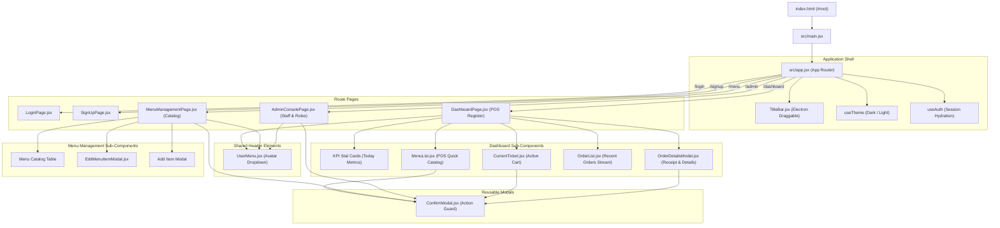
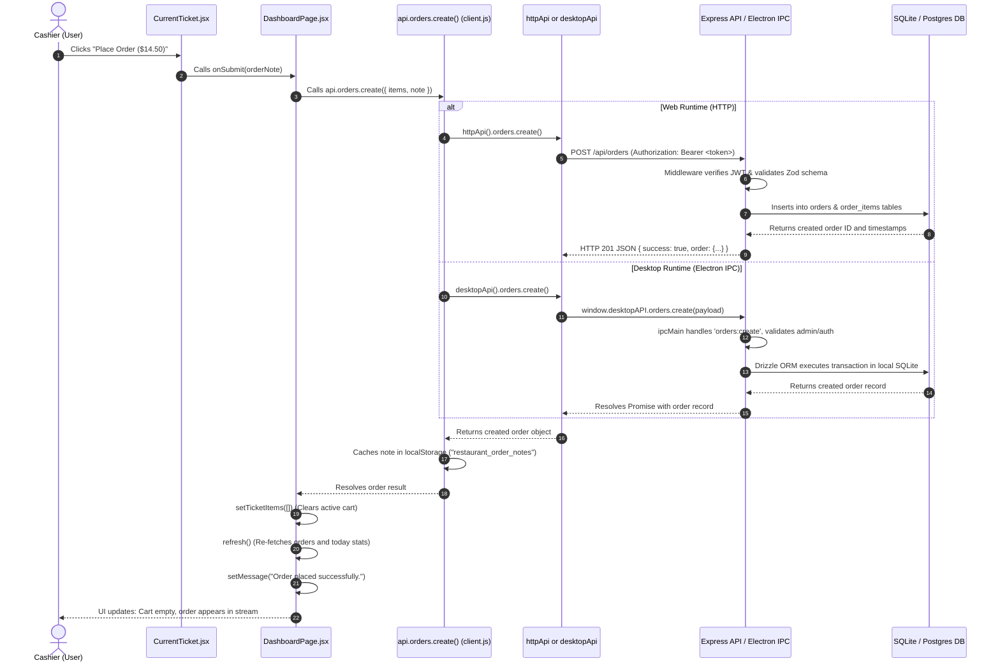

# Frontend Architecture & Developer Guide

Welcome to the frontend documentation for the **Artisan Roast Cafe / Order Management System**. This guide provides an end-to-end technical overview of how the frontend works, its component hierarchy, dual-runtime transport layer, single-point event routing to the backend, practical feature development recipes, and maintenance guidelines.

---

## Table of Contents

1. [High-Level Overview](#1-high-level-overview)
2. [Major UI Elements & Component Hierarchy (Mermaid Graphs)](#2-major-ui-elements--component-hierarchy)
3. [Connecting to the Backend (Dual-Transport Layer)](#3-connecting-to-the-backend-dual-transport-layer)
4. [Single-Point Route to Backend (End-to-End Action Trace)](#4-single-point-route-to-backend-end-to-end-action-trace)
5. [How to Add a New Feature](#5-how-to-add-a-new-feature)
6. [Maintenance & Testing](#6-maintenance--testing)
7. [Future Works & Roadmap](#7-future-works--roadmap)

---

## 1. High-Level Overview

The frontend is built with **React 19** and bundled with **Vite 7**. It is designed as an **offline-first single-page application (SPA)** capable of executing in two distinct environments without code duplication:

1. **Web Browser Target**: Serves over HTTP/HTTPS, communicating with the Express backend REST API (`/api/*`) via standard `fetch()`, using Bearer token authentication and localStorage caching.
2. **Desktop Electron Target**: Runs packaged within Electron via the `file://` protocol. Instead of making network HTTP calls, it invokes Electron IPC channels exposed securely via `contextBridge` in `window.desktopAPI`.

### Key Design Principles

* **Minimalism & Simplicity**: Linear, step-by-step function logic without unnecessary abstractions or complex state management libraries (Redux, MobX, etc.). React's built-in `useState`, `useCallback`, and `useMemo` hooks are used exclusively.
* **Unified API Client Abstraction**: Components never directly invoke `fetch` or `ipcRenderer`. All I/O passes through a single unified `api` client in [`src/api/client.js`](file:///home/fraold/Develop_and_Code/StandardProjects/MERN/Desktop-app/Order-mgmt/app/frontend/src/api/client.js).
* **Zero Login Flash On Reload**: Session credentials (`restaurant_user`) are synchronously hydrated from `localStorage` on initial mount, completely eliminating white screens or premature redirects when refreshing offline.
* **Role-Based Guards**: Administrative controls (staff account provisioning, menu item creation/editing/deletion) are strictly guarded in both UI views and backend/IPC channels based on the user's role (`admin` vs `cashier`).
* **Design System & Theming**: Styled using Tailwind CSS utility classes with native dark and light mode support toggled via `src/utils/theme.js` (`dark` class on `document.documentElement`).

---

## 2. Major UI Elements & Component Hierarchy

### Application Component Tree



### Page Structure & Responsibilities

| Page / Component | Route | Key Responsibilities | Access Role |
| :--- | :--- | :--- | :--- |
| [`LoginPage.jsx`](file:///home/fraold/Develop_and_Code/StandardProjects/MERN/Desktop-app/Order-mgmt/app/frontend/src/features/auth/pages/Login.jsx) | `/login` | Staff authentication, offline credential fallback, redirect to dashboard. | Public |
| [`SignUpPage.jsx`](file:///home/fraold/Develop_and_Code/StandardProjects/MERN/Desktop-app/Order-mgmt/app/frontend/src/features/auth/pages/SignUp.jsx) | `/signup` | Initial store setup, registration of administrator or initial staff account. | Public |
| [`DashboardPage.jsx`](file:///home/fraold/Develop_and_Code/StandardProjects/MERN/Desktop-app/Order-mgmt/app/frontend/src/pages/DashboardPage.jsx) | `/dashboard` | Primary POS terminal: order creation, menu item selection, live cart editing, recent orders inspection, offline sync indicator. | Cashier, Admin |
| [`MenuManagementPage.jsx`](file:///home/fraold/Develop_and_Code/StandardProjects/MERN/Desktop-app/Order-mgmt/app/frontend/src/pages/MenuManagementPage.jsx) | `/menu` | Catalog administration: view items, search, category filters. Admin: add, edit, price, delete. Non-admin: read-only view. | Cashier (Read-only), Admin (Full) |
| [`AdminConsolePage.jsx`](file:///home/fraold/Develop_and_Code/StandardProjects/MERN/Desktop-app/Order-mgmt/app/frontend/src/pages/AdminConsolePage.jsx) | `/admin` | Store administration: provision staff accounts, assign roles (`admin` vs `cashier`), deactivate staff, system overview. | Admin Only |
| [`UserMenu.jsx`](file:///home/fraold/Develop_and_Code/StandardProjects/MERN/Desktop-app/Order-mgmt/app/frontend/src/features/common/UserMenu.jsx) | Global Header | Consolidated circular user profile trigger with dropdown menu for role tag, quick navigation links, and logout. | All Authenticated |
| [`ConfirmModal.jsx`](file:///home/fraold/Develop_and_Code/StandardProjects/MERN/Desktop-app/Order-mgmt/app/frontend/src/features/common/ConfirmModal.jsx) | Reusable Modal | Theme-aware confirmation prompt replacing raw `window.confirm()` before any destructive action (delete item, clear cart, cancel ticket, remove staff). | All Authenticated |

---

## 3. Connecting to the Backend (Dual-Transport Layer)

All frontend communication with data stores is centralized in [`src/api/client.js`](file:///home/fraold/Develop_and_Code/StandardProjects/MERN/Desktop-app/Order-mgmt/app/frontend/src/api/client.js).

```mermaid
flowchart LR
    Component["UI Component (e.g. DashboardPage)"] --> Client["api Client Facade (client.js)"]
    
    Client --> RuntimeCheck{"isDesktop?"}
    
    RuntimeCheck -->|False (Web Browser)| HTTPTransport["httpApi()"]
    RuntimeCheck -->|True (Electron App)| DesktopTransport["desktopApi()"]
    
    subgraph WebPipeline ["Web HTTP Pipeline"]
        HTTPTransport --> Fetch["fetch(/api/...) + Bearer Token"]
        Fetch --> Express["Express Server (Port 8000)"]
        HTTPTransport -.-> LocalCacheWeb["localStorage Cache & Offline Queue"]
    end
    
    subgraph DesktopPipeline ["Desktop IPC Pipeline"]
        DesktopTransport --> WindowAPI["window.desktopAPI (preload.js)"]
        WindowAPI --> IPCMain["ipcRenderer.invoke(...)"]
        IPCMain --> ElectronBackend["Main Process & Local SQLite DB"]
        DesktopTransport -.-> LocalStorageDesk["localStorage (User / Notes / Categories)"]
    end
```

### Runtime Detection
```javascript
// src/api/client.js
const isDesktop = typeof window !== "undefined" && Boolean(window.desktopAPI);
export const api = isDesktop ? desktopApi() : httpApi();
```

### Unified API Contract
Components invoke identical methods regardless of whether they are running on the web or in the desktop build:

* **Authentication**: `api.auth.login()`, `api.auth.signup()`, `api.auth.logout()`, `api.auth.me()`
* **Menu**: `api.menu.list()`, `api.menu.create()`, `api.menu.update()`, `api.menu.delete()`
* **Orders**: `api.orders.list()`, `api.orders.create()`, `api.orders.setStatus()`
* **Dashboard**: `api.dashboard.today()`
* **Staff**: `api.staff.list()`, `api.staff.create()`, `api.staff.delete()`
* **Store Settings**: `api.store.get()`, `api.store.save()`
* **Sync / Offline**: `api.sync.syncNow()`, `api.sync.getPendingCount()`, `api.sync.isOnline()`

### Offline Resilience & Queue Synchronization
In the web environment (`httpApi`), if a network request fails:
1. Orders are saved locally in `localStorage` under `restaurant_orders_cache`.
2. Failed order payloads are queued in `restaurant_sync_queue`.
3. When network connectivity is restored (`window.ononline`), `syncOfflineQueue()` automatically replays queued transactions to the central server.
4. Categories are kept synchronized in `restaurant_menu_categories` to ensure custom and predefined categories persist across reloads.

---

## 4. Single-Point Route to Backend (End-to-End Action Trace)

To understand how a single UI event traverses the entire stack, here is a detailed end-to-end trace of **Placing an Order from the POS Register**:



### Detailed Breakdown of What Each Layer Touches:

1. **UI Layer ([`CurrentTicket.jsx`](file:///home/fraold/Develop_and_Code/StandardProjects/MERN/Desktop-app/Order-mgmt/app/frontend/src/features/orders/pages/CurrentTicket.jsx))**:
   * Reads state: `items` (cart line items with ID, quantity, price), `note` (ticket note).
   * Calculates subtotal, tax, and grand total via [`order.js`](file:///home/fraold/Develop_and_Code/StandardProjects/MERN/Desktop-app/Order-mgmt/app/frontend/src/utils/order.js).
   * Triggers callback `onSubmit(note)` and sets `submitting = true` to prevent double-submissions.
2. **Page Layer ([`DashboardPage.jsx`](file:///home/fraold/Develop_and_Code/StandardProjects/MERN/Desktop-app/Order-mgmt/app/frontend/src/pages/DashboardPage.jsx))**:
   * Formats the payload into clean backend DTO:
     ```json
     {
       "items": [{ "menuItemId": 2, "quantity": 1, "priceCents": 450 }],
       "note": "Table 4 - Extra hot"
     }
     ```
   * Calls `await api.orders.create(payload)`.
3. **Client Transport Layer ([`src/api/client.js`](file:///home/fraold/Develop_and_Code/StandardProjects/MERN/Desktop-app/Order-mgmt/app/frontend/src/api/client.js))**:
   * If **Web**: Sends HTTP `POST /api/orders` with headers `Content-Type: application/json` and `Authorization: Bearer <token>`.
   * If **Desktop**: Sends IPC message via `window.desktopAPI.orders.create(payload)`.
   * If **Offline Web**: Catches fetch failure, creates local offline ticket, appends to `restaurant_sync_queue`.
   * Saves customer notes into `localStorage["restaurant_order_notes"]`.
4. **Backend Services Layer**:
   * Validates schema via Zod (`createOrderSchema`).
   * Resolves item prices against database to prevent client tampering.
   * Inserts order record into database within an atomic transaction.
5. **UI Reconciliation**:
   * Ticket state is cleared (`setTicketItems([])`).
   * `refresh()` triggers parallel re-fetch of `api.menu.list()`, `api.orders.list()`, and `api.dashboard.today()`.
   * React re-renders: Active tickets counter and daily revenue KPIs update immediately.

---

## 5. How to Add a New Feature

Follow this practical, step-by-step checklist when introducing a new feature to the frontend:

### Step 1: Define API Methods in `client.js`
Always start by defining methods in both `httpApi` and `desktopApi` inside [`src/api/client.js`](file:///home/fraold/Develop_and_Code/StandardProjects/MERN/Desktop-app/Order-mgmt/app/frontend/src/api/client.js):
```javascript
// Example: Adding customer discounts
// Inside httpApi():
discounts: {
  list: async () => request("/api/discounts"),
  apply: async (code) => request("/api/discounts/apply", { method: "POST", body: JSON.stringify({ code }) }),
},

// Inside desktopApi():
discounts: {
  list: guard(window.desktopAPI.discounts?.list),
  apply: guard(window.desktopAPI.discounts?.apply),
},
```

### Step 2: Create Feature Components
Create modular components under `src/features/<domain>/`:
* Keep files under 50–100 lines where practical.
* Prefer linear functions over classes.
* Follow the existing Tailwind design tokens:
  * Surface backgrounds: `bg-white dark:bg-stone-900`
  * Text: `text-stone-900 dark:text-stone-100` (muted: `text-stone-400 dark:text-stone-500`)
  * Accent brand color: `bg-amber-600 dark:bg-amber-500`
  * Borders: `border-stone-200 dark:border-stone-800`
  * Corner radii: `rounded-xl` or `rounded-2xl`
* For destructive actions (deletion, clearing data), always use `<ConfirmModal />`.

### Step 3: Create or Update Page View
Mount your feature inside an existing page or create a dedicated page under `src/pages/<NewPage>.jsx`:
* Include the standard top header with brand title, navigation tabs, theme toggle, and `<UserMenu />`.
* Enforce role permissions if applicable:
  ```javascript
  const isAdmin = user?.role === "admin";
  ```

### Step 4: Register the Route in `src/app.jsx`
If the feature has its own page route, register it in [`src/app.jsx`](file:///home/fraold/Develop_and_Code/StandardProjects/MERN/Desktop-app/Order-mgmt/app/frontend/src/app.jsx):
```jsx
<Route
  path="/discounts"
  element={
    <RequireAuth user={user}>
      <DiscountsPage user={user} onLogout={logout} />
    </RequireAuth>
  }
/>
```

### Step 5: Test and Verify
1. Run automated frontend unit tests:
   ```bash
   pnpm --filter @restaurant/frontend test
   ```
2. Run production Vite build:
   ```bash
   pnpm build:frontend
   ```

---

## 6. Maintenance & Testing

### Key Commands

| Command | Action |
| :--- | :--- |
| `pnpm --filter @restaurant/frontend dev` | Starts local Vite development server on `http://localhost:5173`. |
| `pnpm --filter @restaurant/frontend test` | Runs Node.js native test suite (`test/**/*.test.js`). |
| `pnpm --filter @restaurant/frontend build` | Builds optimized production bundle in `app/frontend/dist`. |

### Writing Tests
Frontend tests are located in [`app/frontend/test/`](file:///home/fraold/Develop_and_Code/StandardProjects/MERN/Desktop-app/Order-mgmt/app/frontend/test/) and use Node's native test runner (`node:test` and `node:assert/strict`):
* Focus tests on core business logic, utility calculations, order formatting, and parsing.
* Test files should have zero external mocking framework dependencies.

### Coding Rules & Quality Checklist
* **No Premature Abstractions**: Do not create helper wrappers or utility files for one-off operations.
* **Preserve Functionality**: Never remove existing comments, docstrings, or tests.
* **Fail Fast & Explicitly**: Surface user-friendly error banners when API calls fail (`try/catch` with `setMessage(err.message)`).
* **Confirm Destructive Operations**: Always present `<ConfirmModal />` before permanently modifying or deleting data.

---

## 7. Future Works & Roadmap

The following architectural enhancements are queued for upcoming iterations:

1. **Phase 4: Financial Ledgers & Settlement Reports (`/finance`)**
   * Dedicated accounting dashboard for daily cash drawer reconciliation, sales tax liability summaries, and end-of-day revenue reports.
   * CSV and JSON data export capabilities for external accounting software.
2. **Multi-Printer Kitchen Routing (KDS)**
   * Hardware printer selection modal in Store Profile.
   * Route food items to the kitchen ticket printer and drink items to the barista receipt printer via Electron native printing channels.
3. **Interactive Table Layout Canvas**
   * Visual table floor plan editor in the POS register.
   * Color-coded table occupancy indicators (vacant, active ticket, bill presented).
4. **WebSocket / Server-Sent Events (SSE) Live Sync**
   * Real-time order status updates pushed across multiple terminals in high-volume environments without requiring manual polling.
